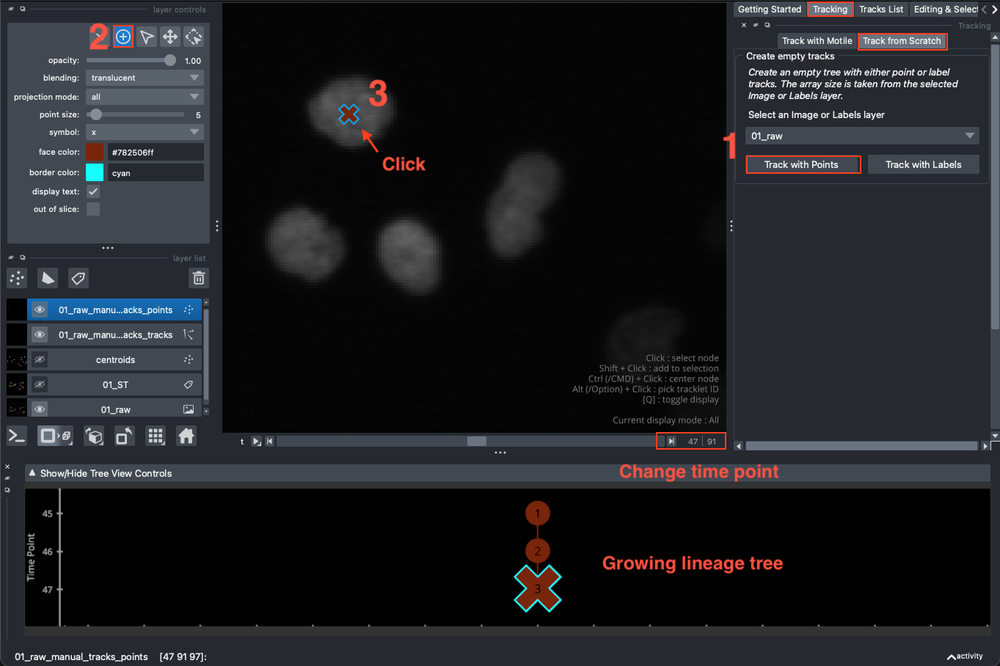
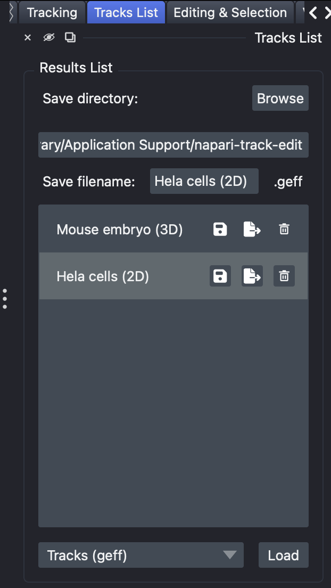

Generating new tracks
=====================

New tracks can be created by hand in the ``Track from Scratch`` tab of the ``Tracking``
widget. Tracks that were generated elsewhere can also be :doc:`imported <saving_loading>`.

Tracking from scratch
*********************
The ``Track from Scratch`` tab of the ``Tracking`` widget offers the option to create an
empty tree that you can populate yourself by adding nodes as points or as segmentation
labels.

Select an ``Image`` (or ``Labels``) layer in the dropdown menu; its size and scale are
used for the new tracks. Then click either ``Track with Points`` or ``Track with Labels``.
Depending on your choice, this creates either an empty ``Points`` layer or an empty
``Labels`` layer, and a new entry ``<layer name>_manual_tracks`` in the ``Tracks List``.

- **Track with Points**: select the ``Add points`` tool in the layer controls, and click
  on an object to add a node. Move to the next time point, and click again on the same
  object: the new node is added to the current track, and you will see a growing lineage
  tree in the Lineage View.
- **Track with Labels**: select the paint brush and paint an object to add a node.
  Move to the next time point, and paint again with the same label: the new node is added
  to the same track.

Press ``M`` to start a new track. See :ref:`add-node` for all details on how new nodes
are added to the tracks, and :doc:`editing` for how to connect, break, and correct them.

   Manual tracking with Points.

The Tracks List
***************
Each tracking result, whether from tracking from scratch or loaded from disk,
is stored in the ``Tracks List`` widget.
These are the tracks that are stored in memory - you can click back and forth
between the results here to compare them.
Deleting tracks you do not want to keep viewing (with the trash can button) is a good
idea, since these are stored in memory.
Tracks that were saved in previous sessions do not appear here until you load them from
disk with the ``Load`` button. See :doc:`saving_loading` for saving, loading, importing,
and exporting tracks.

   The Tracks List, with one entry per set of tracks.
